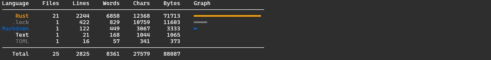
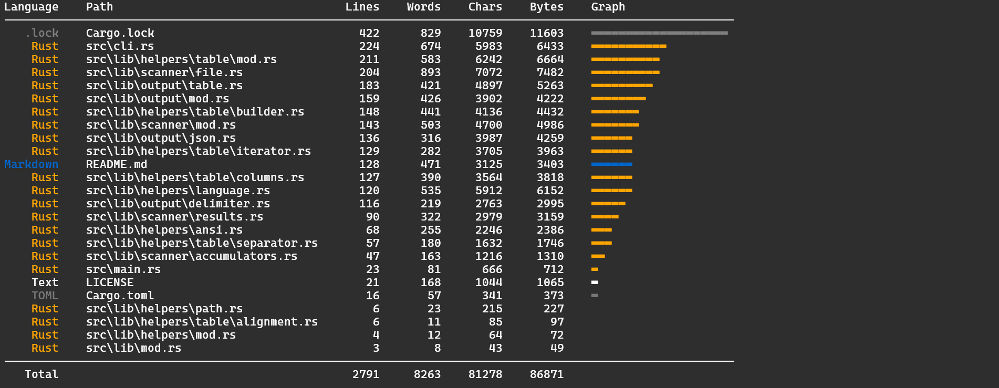

# `tali`

A command-line application to count the number of lines, words, characters and bytes in a given set of files.



## 🌟 Features

- **Scanning**: Scan a set of files (or directories) for the number of lines, words, characters and bytes.
- **Language Detection**: Determines the languages used (based on the file extension)
- **Configurable Output**: Choose from multiple output formats (Table, CSV, TSV, JSON)
- **Colorized**: Defaults to a colorized output when printing to the console.
- **Visualization**: Displays a graphical measure of each file's size relative to the largest file.
- **Group by Language**: Aggregate and group the results by language

---

## 📦 Installation

Download the archive for your platform from the [latest release](https://github.com/Shresht7/tali/releases/latest):

- Linux (x86_64): `tali-x86_64-unknown-linux-gnu.tar.gz`
- macOS (Intel): `tali-x86_64-apple-darwin.tar.gz`
- Windows (x86_64): `tali-x86_64-pc-windows-msvc.zip`

Each archive contains the executable, this README, and the MIT license. Extract it and run `tali` (or `tali.exe` on Windows); no renaming is needed. To use it from any directory, add the extracted executable's location to your `PATH`.

## 📘 Usage

Run `tali` by specifying one or more files or directories to scan:

```sh
tali path/to/directory
```

By default, `tali` outputs the results in a tabular format with colors.



The output can be configured using the various command-line arguments.

### Options

- `-l, --lines`: Shows the line count
- `-w, --words`: Show the word count
- `-c, --chars`: Shows the character count
- `-b, --bytes`: Show the byte count
- `-e, --language`: Show the corresponding language
- `-v, --graph`: Show a graphical visualization
- `-f, --format`: Configures the output format (`"table"`, `"json"`, `"plain"`)
- `--sort-by [metric]`: Sorts the output by the specified metric (`lines`, `words`, `chars` or `bytes`)
- `--sort-order [order]`: Sorts in `ascending` or `descending` order
- `--graph-by [metric]`: Uses the specified metric for the graphical visualization (`lines`, `words`, `chars`, or `bytes`)

Use `--help` to get the full help for more details.

### Examples

#### Scan the current directory

```sh
tali
```

#### Scan a specific directory

```sh
tali src
```

#### Count lines in a file

```sh
tali README.md --lines
```

#### Scan a directory and group results by languages

```sh
tali projects --group
```

#### Show language, lines, and characters in JSON format

```sh
tali src --language --lines --chars --format json
```

#### Scan multiple files and output as plain text

```sh
tali README.md .gitignore src --lines --format plain
```

#### Exclude specific files

```sh
tali src --exclude "*.md,*.toml"
```

---

## ⚽ Goals

- Learn Rust
- Build Stuff

## 🖥️ Development

### Project Structure

The cli logic resides in [`main.rs`](./src/main.rs) and the definitions for the command-line arguments are in the [`cli.rs`](./src/cli.rs) file.

The library [`src/lib`](./src/lib/) contains three modules:
- [`scanner`](./src/lib/scanner/): Responsible for walking the file-system and scanning the file metrics
- [`output`](./src/lib/output/): Responsible for formatting and displaying the scan results.
- [`helpers`](./src/lib/helpers/): An amalgamation of helpers and utilities used throughout the project.

### 📕 References

- https://github.com/XAMPPRocky/tokei
- https://boyter.org/posts/sloc-cloc-code/
- https://github.com/cgag/loc
- https://github.com/boyter/scc

---

## 📄 License

This project is licensed under the [MIT LICENSE](./LICENSE). See the [LICENSE](./LICENSE) file for more details.
